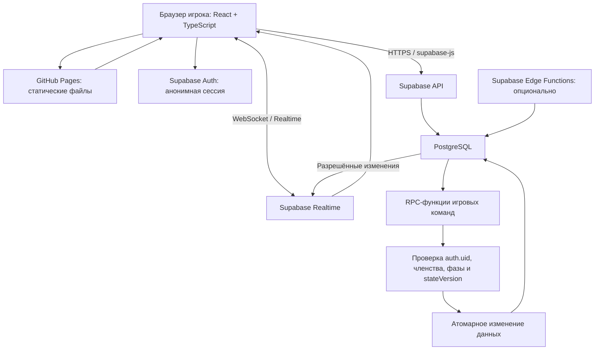

# 03_Technical_Specification — техническое задание браузерной игры «Бункер»

> **Версия:** 0.2  
> **Дата обновления:** 03.11.2026  
> **Статус:** проект технического задания; до начала реализации требуется проверить регистрацию на бесплатных тарифах и доступность сервисов из сетей будущих игроков.  
> **Назначение:** определить технологический стек, архитектуру, структуру данных, безопасность, интерфейс, тестирование и бесплатное развёртывание браузерной игры.  
> **Платформы:** браузерный ПК, планшет и смартфон.  
> **Целевая нагрузка первой версии:** до 25 одновременно подключённых игроков; допускается несколько независимых комнат при соблюдении лимитов бесплатных сервисов.  
> **Документы-основания:** `01_Game_Rules.md`, `02_Game_System.md`.  
> **Первоисточник игровых правил:** `Bunker_MDK0401_Materials.xlsx`.

---

## 0. Как читать документ

В документе используются три статуса требований:

- **[ОБЯЗАТЕЛЬНО]** — требование, необходимое для корректной и безопасной реализации.
- **[РЕКОМЕНДАЦИЯ]** — предлагаемое техническое решение; его можно уточнить без изменения оригинальных игровых правил.
- **[ТРЕБУЕТ СОГЛАСОВАНИЯ]** — решение, которое нельзя окончательно реализовать до уточнения игрового правила или организационного условия.

Техническая архитектура не должна самостоятельно разрешать вопросы из реестра `02_Game_System.md`. Нельзя придумывать порядок раскрытия карт, способ разрешения ничьей, формулу вместимости, новые эффекты или условия применения существующих карт.

Термины **MUST / SHOULD / MAY** в технических разделах означают соответственно «обязательно», «рекомендуется» и «допускается».

### 0.1. Что изменилось в версии 0.2

Версия 0.2 заменяет инфраструктуру Google Cloud Run + Firebase на бесплатную архитектуру GitHub Pages + Supabase Free.

| Было в версии 0.1 | Стало в версии 0.2 |
|---|---|
| Google Cloud Run | GitHub Pages для статического интерфейса |
| Firebase Authentication | Supabase Auth с анонимным входом |
| Cloud Firestore | Supabase PostgreSQL |
| Firestore listeners | Supabase Realtime |
| Node.js API на Cloud Run | PostgreSQL RPC как основной слой игровых команд; Supabase Edge Functions — только при необходимости |
| Firebase Security Rules | PostgreSQL RLS, SQL grants и контролируемые RPC-функции |
| Серверная сборка приложения | Статическая сборка React/Vite |

**Причина изменения:** пользователь выбрал приоритет полностью бесплатного размещения; зарубежная инфраструктура допустима, но игрокам должно быть возможно подключаться без VPN. Доступность из российских сетей является обязательным условием проверки, а не гарантированным свойством GitHub Pages или Supabase.

### 0.2. Принцип бесплатного размещения

**[ОБЯЗАТЕЛЬНО]** В первой версии не подключать платные тарифы, платные дополнения, платный домен, платные функции и платные лимиты.

**[ОБЯЗАТЕЛЬНО]** До создания основной инфраструктуры проверить, что GitHub и Supabase позволяют зарегистрировать и создать нужные бесплатные проекты без привязки банковской карты. Официальные страницы описывают тариф Free как бесплатный, однако наличие требования к карте может зависеть от текущей процедуры регистрации, проверки аккаунта или региона. Если на этапе регистрации будет запрошена карта, остановиться и согласовать альтернативу; не обходить проверку чужими платёжными данными.

**[ОБЯЗАТЕЛЬНО]** Не включать автоматическое обновление до платного тарифа и не добавлять платёжный метод. При достижении бесплатного лимита система должна ограничить соответствующую функцию и показать владельцу понятное уведомление, а не предполагать оплату.

**[ВАЖНО]** Бесплатный тариф не означает гарантированную доступность 24/7, SLA, автоматические резервные копии или доступность без VPN у каждого оператора связи.

## 1. Назначение продукта

Создать адаптивную многопользовательскую браузерную игру по учебной игре «Бункер» в предметной области МДК.04.01.

Система должна позволять участникам подключаться к одной комнате с разных устройств, видеть общее состояние партии в реальном времени и выполнять только те действия, которые разрешены утверждёнными правилами.

### 1.1. Основные цели

1. Перенести исходные игровые материалы в цифровой каталог карточек без изменения формулировок.
2. Реализовать создание комнаты и подключение по коду или ссылке.
3. Разделить публичную и закрытую игровую информацию.
4. Поддерживать согласованную последовательность игровых фаз и раундов.
5. Обеспечить синхронизацию состояния между участниками.
6. Реализовать карточные эффекты только по утверждённым спецификациям.
7. Поддерживать финальный технический аудит восстановления инфраструктуры.
8. Обеспечить работу на ПК и смартфонах в одном веб-приложении.
9. Развернуть первую версию без обязательной ежемесячной оплаты и без требования VPN как со стороны самого приложения.
10. Проверить доступность сайта и игрового соединения из реальных сетей, которыми пользуются участники.

### 1.2. Не входит в первую версию

- Нативные приложения для iOS и Android.
- Обязательная регистрация через электронную почту, телефон или социальные сети.
- Встроенный голосовой или видеочат.
- Автоматическая оценка знаний нейросетью.
- Использование Gemini или другой нейросети для принятия игровых решений, определения победителей или применения эффектов.
- Собственная система платежей, рейтингов и публичного матчмейкинга.
- Редактор оригинальных правил, позволяющий обычному игроку менять свойства карточек.
- Гарантированная офлайн-игра.
- Отдельный постоянно работающий Node.js-сервер или VPS.

Эти возможности могут обсуждаться отдельно и не должны задерживать реализацию базовой игры.

## 2. Выбранный технологический стек

### 2.1. Состав технологий

| Уровень | Технология | Назначение | Статус |
|---|---|---|---|
| Клиент | React | Страницы и интерактивный интерфейс | Рекомендуется |
| Язык клиента | TypeScript | Типизация данных, игровых состояний и запросов | Обязательно |
| Сборщик | Vite | Сборка статических файлов для GitHub Pages | Рекомендуется |
| Стили | CSS Modules или обычный CSS с design tokens | Реализация макетов Figma и адаптивности | Рекомендуется |
| Маршрутизация | React Router `HashRouter` | Клиентские маршруты на статическом хостинге без серверного rewrite | Рекомендуется |
| Хостинг интерфейса | GitHub Pages | Публикация статических HTML/CSS/JS-файлов | Рекомендуется |
| База данных | Supabase PostgreSQL | Игровые комнаты, участники, состояние, карточки и результаты | Рекомендуется |
| Авторизация | Supabase Auth Anonymous Sign-Ins | Временная учётная запись игрока без email и пароля | Рекомендуется |
| Реальное время | Supabase Realtime | Синхронизация публичного состояния и присутствия игроков | Рекомендуется |
| Серверные команды | PostgreSQL RPC-функции | Проверка и атомарное выполнение игровых команд | Обязательно |
| Дополнительная серверная логика | Supabase Edge Functions (Deno/TypeScript) | CAPTCHA, дополнительная проверка запросов и внешние интеграции при необходимости | Дополнительно |
| Репозиторий | GitHub | История изменений и автоматическая публикация | Обязательно |
| Среда разработки с ИИ | Google AI Studio Build или локальная IDE | Создание и редактирование исходного кода | Рекомендуется |
| PWA | Web App Manifest + Service Worker | Установка сайта на главный экран после стабилизации | Дополнительный этап |

### 2.2. Разделение обязанностей сервисов

**GitHub Pages** обслуживает только статическую клиентскую часть: HTML, CSS, JavaScript, шрифты и публичные графические ресурсы. GitHub Pages не исполняет Node.js, не хранит серверные секреты и не выполняет игровую логику на сервере.

**Supabase** предоставляет PostgreSQL, Auth и Realtime. Игровые изменения выполняются контролируемыми функциями базы данных (RPC), которые проверяют личность пользователя, членство в комнате, текущую фазу, права и версию состояния.

**Google AI Studio** используется как инструмент разработки. Он не является обязательным звеном опубликованной игры и не должен получать игровые запросы участников во время партии.

### 2.3. Почему не нужен отдельный Node.js-сервер

Для пошаговой карточной игры на 25 игроков отдельный постоянно работающий Node.js-сервер не обязателен.

PostgreSQL RPC позволяет выполнять проверку и изменение нескольких связанных записей внутри одной транзакции. Supabase Realtime распространяет подтверждённые изменения подписанным клиентам. Это сокращает число компонентов, которые нужно настраивать и обслуживать.

Отдельный сервер можно добавить позднее, если появятся требования, которые неудобно или небезопасно реализовать через PostgreSQL RPC и Edge Functions. Это не является условием первой версии.

### 2.4. Ссылки и маршрутизация GitHub Pages

GitHub Pages размещает статические файлы. Прямой переход по адресу вида `/room/ABC/game` может вернуть 404, поскольку у хостинга нет собственного серверного роутера для React.

**[РЕКОМЕНДАЦИЯ]** Использовать `HashRouter`, чтобы адреса имели вид `https://<owner>.github.io/<repository>/#/room/<roomId>/game`. Это позволяет открывать и обновлять внутренние страницы без отдельной серверной настройки rewrite.

Vite должен быть настроен с корректным `base`, учитывающим имя репозитория. Если проект будет опубликован как пользовательский сайт `<owner>.github.io`, настройка `base` может отличаться.

### 2.5. Работа с макетами Figma

После утверждения Figma-макетов разработка должна переносить:

- структуру экранов и компонентов;
- дизайн-токены: цвета, типографику, размеры, интервалы, радиусы и тени;
- состояния компонентов: обычное, наведение, нажатие, фокус, отключено, ошибка и загрузка;
- варианты карточек по категориям;
- правила перестроения интерфейса между ПК и мобильным экраном.

**[ОБЯЗАТЕЛЬНО]** Не использовать PNG-макет как единственный способ реализации интерфейса. Карточки, кнопки, панели, списки и диалоги должны быть настоящими компонентами интерфейса.

Иллюстрации могут быть отдельными изображениями. Текст названия и свойства карточки остаётся текстом интерфейса.

### 2.6. Ограничения бесплатного Supabase

Публичная документация Supabase на дату проверки указывает следующие основные квоты Free:

| Ресурс | Лимит Free | Значение для проекта |
|---|---:|---|
| Активные проекты | До 2 | Достаточно для тестового и основного проекта при грамотном использовании |
| Размер базы данных | 500 МБ на проект | Достаточно для структурированных игровых данных первой версии |
| ОЗУ базы | 500 МБ, shared CPU | Нужна оптимизация запросов и индексов |
| Monthly Active Users | 50 000 | Значительно больше целевой аудитории проекта |
| Egress | 5 ГБ uncached + 5 ГБ cached | Не отдавать крупные файлы через API без необходимости |
| Storage | 1 ГБ | Для небольшого набора графических файлов, если потребуется |
| Edge Function invocations | 500 000 / месяц | Допустимо для небольшого числа дополнительных запросов |
| Realtime messages | 2 000 000 / месяц | Не отправлять повторные таймерные обновления каждую секунду |
| Peak Realtime connections | 200 | Целевые 25 игроков укладываются с запасом по соединениям |
| Realtime messages per second | 100 | Избегать массовых частых публикаций |

Квоты могут измениться. Перед запуском проверить текущую страницу тарифов и лимиты в панели проекта.

**Важные ограничения Free:**

- Если проект получает слишком мало активности в течение недели, Supabase может приостановить его. Данные при этом сохраняются, но для восстановления может понадобиться действие владельца в панели Supabase.
- В Free нет автоматических резервных копий базы уровня платных тарифов.
- Нет SLA и гарантии бесперебойной работы.
- При превышении квот сервис может ограничить соответствующие функции; переход на платный тариф не должен происходить автоматически.

**[ОБЯЗАТЕЛЬНО]** Перед запланированной игровой сессией владелец проверяет, что Supabase-проект активен и тестовое подключение проходит успешно.

## 3. Архитектура приложения

### 3.1. Общая схема



### 3.2. Клиентская часть

Клиент отвечает за отображение интерфейса, ввод действий пользователя и подписку на разрешённые публичные и приватные данные.

Клиент НЕ является источником истины для:

- состава игроков и их игровых статусов;
- назначения карточек;
- открытия чужих закрытых карточек;
- результатов голосования;
- применения карточных эффектов;
- переходов между фазами;
- вместимости и определения завершения партии;
- времени окончания фазы.

Клиент отправляет намерение выполнить действие через RPC-функцию и отображает подтверждённое базой данных состояние.

### 3.3. Авторитетная серверная логика

В первой версии роль серверного слоя выполняют PostgreSQL RPC-функции и, при необходимости, Supabase Edge Functions.

Каждая игровая команда должна:

1. Определить пользователя через `auth.uid()` из Supabase JWT, а не доверять `userId`, переданному браузером.
2. Проверить, что пользователь состоит в указанной комнате.
3. Проверить его техническую роль и доступ к команде.
4. Проверить текущую фазу, статус комнаты и допустимость действия.
5. Проверить `expectedStateVersion`, если команда зависит от текущей версии состояния.
6. Обеспечить идемпотентность по `commandId`.
7. Атомарно обновить все связанные строки.
8. Записать публичное событие и/или приватное уведомление в соответствующие таблицы.
9. Вернуть структурированный результат.

Нельзя принимать от клиента готовый объект нового состояния игры и просто сохранять его в базе.

### 3.4. Игровой движок

**[ОБЯЗАТЕЛЬНО]** Логику игры нужно отделить от React-компонентов и от визуального дизайна.

Рекомендуется хранить тестируемую модель переходов и общие TypeScript-типы в `src/game-engine/`, а транзакционные операции — в SQL-миграциях Supabase.

Ключевые проверки должны существовать на стороне базы данных. Проверка только в браузере недостаточна, поскольку запрос можно отправить вручную.

### 3.5. Обработка ошибок и доступность

Если Supabase недоступен, приложение должно показать понятное сообщение о потере соединения и не подтверждать невыполненное действие.

Если сайт GitHub Pages загрузился, но API или WebSocket Supabase недоступны из сети игрока, игра не должна переходить в частично рабочее состояние. Показывается экран подключения с возможностью повторить попытку.

**[ОБЯЗАТЕЛЬНО]** Не утверждать, что выбранная зарубежная инфраструктура доступна без VPN у всех операторов России. Это проверяется фактическими тестами из сетей игроков.

## 4. Авторизация и роли доступа

### 4.1. Вход игрока

**[РЕКОМЕНДАЦИЯ]** Использовать Supabase Anonymous Sign-Ins.

Ожидаемый поток:

1. При первом запуске приложение вызывает `supabase.auth.signInAnonymously()`.
2. Supabase создаёт анонимного пользователя и выдаёт JWT.
3. Игрок задаёт отображаемое игровое имя.
4. При создании или подключении к комнате RPC связывает `auth.uid()` с внутренним `member_id`.
5. При повторном открытии сайта Supabase JS восстанавливает сохранённую сессию, если локальные данные браузера не были удалены.

Анонимная учётная запись не равна постоянному аккаунту. Если игрок выйдет из учётной записи, очистит данные браузера или перейдёт на другое устройство, восстановить прежнюю анонимную учётную запись может быть невозможно.

**[ТРЕБУЕТ СОГЛАСОВАНИЯ]** Решить, достаточно ли временной анонимной сессии или позднее нужен механизм привязки постоянного аккаунта.

**Ограничение против злоупотреблений:** Supabase указывает ограничение частоты анонимных входов по IP и рекомендует CAPTCHA/Turnstile или другой поддерживаемый CAPTCHA-провайдер. В аудитории, где много учеников выходят в интернет через один общий IP, нужно проверить, не мешает ли ограничение одновременному входу 25 человек. Это проверить до игровой сессии.

### 4.2. Внутренние технические роли

Технические роли нельзя смешивать с игровыми карточками категории «Роль».

| Техническая роль | Доступ |
|---|---|
| `host` | Создание комнаты и только согласованные административные операции |
| `player` | Участие в партии, чтение собственных закрытых карт и публичного состояния, отправка разрешённых команд |
| `teacher` | Доступ к процедуре подсказки и/или финальной проверке, если это будет утверждено |
| `spectator` | Просмотр только тех данных, которые разрешены для зрителя, если режим зрителя будет утверждён |

Роль хранится в базе. Клиент не может самостоятельно назначить себе `host`, `teacher` или `spectator`.

### 4.3. Полномочия создателя комнаты

**[ТРЕБУЕТ СОГЛАСОВАНИЯ]** До утверждения полномочий создателя комнаты нельзя добавлять функции, позволяющие ему менять игровые результаты, просматривать закрытые карты других игроков или вмешиваться в голосование.

На техническом уровне можно подготовить безопасную панель: отображение участников, код комнаты и доступность сервиса. Игровые административные команды включаются после согласования.

## 5. Структура данных Supabase PostgreSQL

### 5.1. Общие принципы

1. Каталог карточек отделён от экземпляров карточек в конкретной партии.
2. Публичные данные комнаты отделены от закрытых данных игрока.
3. Полное игровое состояние изменяется только контролируемыми SQL-функциями.
4. Все таблицы в API-доступных схемах защищаются RLS и явными SQL grants.
5. Полная история событий не заменяет текущее состояние, а дополняет его.
6. У каждого игрового действия есть идентификатор команды для защиты от повторного выполнения.
7. В таблицах не должно быть лишних персональных данных.

### 5.2. Важное правило размещения каталога

**[ОБЯЗАТЕЛЬНО]** Полный каталог из 180 карточек нельзя помещать в клиентский JavaScript-бандл, публичный JSON или статические файлы GitHub Pages. Пользователь сможет скачать их и заранее увидеть содержимое невыданных карточек.

Рекомендуется загрузить исходные карточки в таблицу `card_catalog` в Supabase PostgreSQL через закрытый административный импорт или SQL Editor. Файл с полным содержимым карточек не должен попадать в публичный GitHub-репозиторий.

Клиент получает только:

- карточки, принадлежащие текущему игроку;
- карточки, которые уже открыты по утверждённым правилам;
- другие публичные карточки, если правила прямо разрешают их отображение.

Иллюстрации можно публиковать отдельно, если они не раскрывают скрытые название, описание или свойства карточки.

### 5.3. Основные таблицы

Предлагаемая логическая структура:

```text
public.rooms
public.room_members
public.game_sessions
public.public_game_state
public.card_instances
public.public_card_reveals
public.crisis_instances
public.votes
public.published_vote_results
public.public_game_events
public.player_private_state
public.player_private_events
public.audit_submissions
public.room_invites
public.command_receipts
public.card_catalog

private.*  # внутренние helper-функции и таблицы, не выставляемые в Data API
```

Физическое разделение таблиц и представлений можно уточнить при создании SQL-миграций. Названия являются предварительными, но граница между публичными и приватными данными обязательна.

### 5.4. Каталог карточек `card_catalog`

| Поле | Тип | Описание |
|---|---|---|
| `card_id` | text / primary key | Постоянный ID, например `role-001` |
| `source_number` | integer | Номер карточки в исходной книге |
| `category` | enum/text | `role`, `skill`, `baggage`, `vulnerability`, `crisis`, `action` |
| `title_original` | text | Исходное название без изменения |
| `description_original` | text | Исходное описание без изменения |
| `illustration_idea_original` | text/null | Идея изображения или `NULL`, если исходное поле пустое |
| `source_sheet` | text | Лист Excel |
| `catalog_version` | text | Версия каталога |
| `effect_handler_id` | text/null | Обработчик эффекта, если он утверждён |
| `effect_status` | enum/text | `not_applicable`, `draft`, `approved`, `disabled` |

**[ОБЯЗАТЕЛЬНО]** В таблице должно быть 180 карточек: ровно 30 в каждой из шести категорий. Количество, уникальность ID и точное совпадение исходных названий/описаний проверяются автоматизированным импортным тестом.

**[ОБЯЗАТЕЛЬНО]** Прямой `SELECT` из `card_catalog` не предоставляется обычному клиенту. Для получения карточек используются контролируемые функции, проверяющие `auth.uid()` и принадлежность игрока к комнате.

### 5.5. Комнаты `rooms`

Минимальные поля:

| Поле | Тип | Назначение |
|---|---|---|
| `id` | uuid | ID комнаты |
| `status` | enum/text | `created`, `lobby`, `in_progress`, `finished`, `archived` |
| `host_member_id` | uuid | Создатель комнаты |
| `ruleset_version` | text | Версия утверждённых правил |
| `catalog_version` | text | Версия каталога карточек |
| `schema_version` | integer | Версия структуры данных |
| `created_at` | timestamptz | Серверное время создания |
| `updated_at` | timestamptz | Серверное время обновления |

Код приглашения не хранится в публичной записи комнаты. В `room_invites` хранится хэш кода и связь с комнатой. Сам код создаётся криптографически безопасным генератором; поиск комнаты и вход выполняются контролируемой RPC-функцией с ограничением частоты попыток.

### 5.6. Участники `room_members`

Минимальные поля:

| Поле | Тип | Назначение |
|---|---|---|
| `id` | uuid | Внутренний ID участника в комнате |
| `room_id` | uuid | Ссылка на комнату |
| `auth_user_id` | uuid | `auth.uid()` анонимной/постоянной учётной записи |
| `display_name` | text | Игровое имя |
| `technical_role` | enum/text | Техническая роль доступа |
| `status` | enum/text | Состояние участника согласно согласованной модели |
| `joined_at` | timestamptz | Время подключения |
| `last_seen_at` | timestamptz/null | Последнее подтверждённое действие/присутствие |

Должно быть уникальное ограничение на активное членство одной учётной записи в одной комнате. Игровые статусы и правила выхода определяются `02_Game_System.md`, а не структурой таблицы.

### 5.7. Игровое состояние `game_sessions` и `public_game_state`

`game_sessions` хранит авторитетное серверное состояние:

- `room_id`;
- `status`;
- `round_number`;
- `phase`;
- `state_version`;
- `ruleset_version`;
- `catalog_version`;
- `deadline_at`;
- `updated_at`.

`public_game_state` содержит только информацию, разрешённую всем участникам:

- публичный статус партии;
- номер текущего раунда и фазу;
- публичные данные участников и их игровые статусы;
- раскрытые карточки;
- активные/выложенные кризисы в согласованном виде;
- публичное состояние таймера;
- опубликованный результат голосования;
- `state_version`.

Закрытые карточки, сырые голоса до разрешённого момента публикации, скрытые цели эффектов и служебные токены не должны попадать в эту таблицу или публичное представление.

### 5.8. Приватные карточки и состояния игроков

`card_instances` связывает конкретный экземпляр с партией, владельцем, состоянием и исходной карточкой.

`player_private_state` хранит только личные сведения, которые нужны конкретному игроку.

**[ОБЯЗАТЕЛЬНО]** Доступ к закрытым данным проверяется через RLS и/или контролируемую функцию, которая использует `auth.uid()`. Нельзя доверять `player_id`, переданному браузером.

### 5.9. Голоса и результаты

Голоса хранятся отдельно от публичного состояния. До согласования точного смысла «открытого голосования» нельзя раскрывать автора и цель каждого голоса в реальном времени.

RPC-функция проверяет:

- что пользователь — действующий участник комнаты;
- что голосование открыто по утверждённому состоянию;
- что выбранная цель допустима;
- что текущий участник ещё может голосовать;
- что команда не была обработана раньше.

Публичная таблица `published_vote_results` обновляется только в утверждённый момент. Точный способ отображения и публикации голосов требует согласования.

### 5.10. Журнал событий `public_game_events` и `player_private_events`

Публичный журнал содержит только события, которые должны видеть участники. Приватный журнал хранит персональные игровые уведомления и закрытые детали.

События не должны позволять восстановить чужую нераскрытую карточку или закрытый голос.

### 5.11. Идемпотентность `command_receipts`

Для каждой команды сохраняются `command_id`, пользователь, комната, тип команды, результат и время обработки. Должно быть уникальное ограничение, предотвращающее повторное выполнение одного `command_id`.

### 5.12. Версионирование

Каждая партия ссылается на:

- `catalog_version` — версию каталога;
- `ruleset_version` — версию утверждённых правил;
- `schema_version` — версию структуры базы;
- `state_version` — текущую версию состояния партии.

Обновление каталога не должно незаметно менять уже начатые партии. Новые изменения оформляются новой версией.

## 6. Серверные команды и API

### 6.1. Общий принцип

Основной способ выполнения игровых команд — `supabase.rpc('function_name', payload)`.

Клиент не обновляет таблицы игрового состояния напрямую. Он вызывает функцию, которая проверяет сессию, членство, права, фазу, версию состояния и только затем выполняет транзакцию.

Пример логического тела команды:

```json
{
  "command_id": "client-generated-uuid",
  "room_id": "room-uuid",
  "expected_state_version": 14,
  "payload": {}
}
```

`auth.uid()` берётся внутри PostgreSQL из проверенного JWT и не должен приниматься как достоверное значение из `payload`.

### 6.2. Предлагаемые RPC-функции

| Функция | Назначение |
|---|---|
| `api_create_room` | Создать комнату и назначить создателя |
| `api_join_room` | Присоединиться по коду приглашения |
| `api_leave_room` | Запросить выход из комнаты |
| `api_set_ready` | Передать готовность, если она будет использоваться |
| `api_start_game` | Запросить запуск партии |
| `api_reveal_card` | Запросить раскрытие разрешённой карты |
| `api_submit_vote` | Подать или изменить голос в разрешённом окне |
| `api_use_action` | Запросить применение карты «Действие» |
| `api_advance_phase` | Запросить переход к следующему состоянию |
| `api_submit_audit` | Отправить финальный план |
| `api_get_my_private_state` | Получить приватные данные текущего участника |
| `api_get_room_snapshot` | Получить разрешённый публичный снимок комнаты |

Это предварительные имена. Функции, зависящие от неутверждённых игровых правил, нельзя считать готовыми к исполнению.

### 6.3. Дополнительные Edge Functions

Supabase Edge Functions работают на Deno и TypeScript. В первой версии они не заменяют PostgreSQL RPC для транзакционных игровых команд.

Их можно добавить для:

- проверки CAPTCHA/Turnstile перед анонимным входом, если это требуется;
- дополнительного ограничения частоты запросов;
- выдачи безопасных служебных ответов;
- будущих внешних интеграций.

Edge Functions не должны содержать единственную копию критического игрового состояния. Если функция вызывает изменения PostgreSQL, она должна передавать авторизацию пользователя и не обходить RLS без строгой необходимости.

### 6.4. Типовой ответ

```json
{
  "ok": true,
  "command_id": "client-generated-uuid",
  "state_version": 15,
  "result": {
    "status": "accepted"
  }
}
```

Машинно-читаемые коды ошибок:

- `UNAUTHENTICATED` — нет действительной авторизации;
- `NOT_ROOM_MEMBER` — пользователь не участник комнаты;
- `FORBIDDEN` — недостаточно прав;
- `ROOM_NOT_FOUND` — комната не найдена;
- `INVALID_PHASE` — действие недоступно в текущей фазе;
- `STALE_STATE` — клиент использовал устаревшую версию;
- `RULE_NOT_APPROVED` — соответствующая процедура ещё не утверждена;
- `ALREADY_PROCESSED` — команда уже выполнялась;
- `VALIDATION_ERROR` — некорректные данные;
- `RATE_LIMITED` — превышено допустимое число запросов;
- `SERVICE_UNAVAILABLE` — база или Realtime временно недоступны.

## 7. Обработка команд и целостность данных

### 7.1. Проверка команды

Для каждой команды серверная функция проверяет:

1. Действителен ли JWT и доступен ли `auth.uid()`.
2. Состоит ли пользователь в комнате.
3. Разрешена ли команда его технической роли.
4. Совпадает ли текущая версия состояния с ожидаемой.
5. Подходит ли команда текущей фазе и статусу участника.
6. Не нарушает ли команда ограничения карточки или эффекта.
7. Не обрабатывался ли этот `command_id` ранее.

### 7.2. Атомарные изменения

Операции, которые должны произойти как единое действие, выполняются внутри одной транзакции PostgreSQL. Функция должна заблокировать необходимую строку состояния комнаты (например, через `SELECT ... FOR UPDATE`), проверить условия, записать изменение, событие и `command_receipt`, затем завершить транзакцию.

Если проверка не пройдена, изменения не должны частично сохраняться.

### 7.3. Безопасность SQL-функций

**[ОБЯЗАТЕЛЬНО]** Не создавать без необходимости функции с повышенными правами.

Предпочтительный подход:

- открытые RPC-функции используют минимально необходимые права;
- внутренние вспомогательные функции размещаются в схеме `private`, не выставленной через Supabase Data API;
- если требуется `SECURITY DEFINER`, функция должна быть в закрытой схеме, иметь закреплённый `search_path` (предпочтительно пустой с полностью квалифицированными именами), минимальные `GRANT EXECUTE` и явные проверки пользователя/комнаты;
- не выдавать `EXECUTE` роли `anon` без отдельного обоснования;
- все grants и RLS-политики создаются SQL-миграциями и покрываются тестами.

Не полагаться только на то, что таблица «не показывается» в интерфейсе Supabase. Доступ определяется правами PostgreSQL и RLS.

### 7.4. Идемпотентность

Повторная отправка одного `command_id` не должна:

- создавать вторую копию карточки;
- повторно применять одноразовый эффект;
- добавлять несколько голосов, если правила не предусматривают изменение голоса;
- повторно исключать игрока;
- повторно менять вместимость.

Повторный запрос возвращает сохранённый результат первой обработки или `ALREADY_PROCESSED`.

### 7.5. Переходы игровых состояний

Система использует явную таблицу разрешённых переходов. Нельзя принимать произвольное значение `phase` от браузера.

Для каждого перехода указываются:

- исходное состояние;
- команда или серверное событие;
- проверка условий;
- новое состояние;
- изменения публичных данных;
- изменения приватных данных;
- создаваемые записи журнала.

Таблица переходов заполняется только по согласованным правилам из `02_Game_System.md`.

## 8. Безопасность и приватность

### 8.1. Правило закрытых карточек

Закрытая карточка должна быть недоступна постороннему участнику на уровне базы данных, а не только скрыта визуально.

Запрещено:

- отправлять все карточки всем браузерам и скрывать часть через CSS;
- помещать полный каталог в публичный JavaScript или JSON;
- класть закрытые свойства в публичную строку состояния комнаты;
- отдавать приватные данные в публичном журнале;
- хранить сервисный ключ Supabase в клиентском коде.

### 8.2. RLS и SQL grants

**[ОБЯЗАТЕЛЬНО]** Включить Row Level Security на всех таблицах, доступных через Supabase Data API.

Для каждой таблицы отдельно определить:

- разрешённые роли PostgreSQL;
- допустимые операции `SELECT`, `INSERT`, `UPDATE`, `DELETE`;
- RLS-политики `USING` и `WITH CHECK`;
- необходимость полностью закрыть прямые клиентские записи и разрешить изменения только через RPC.

Важно: RLS не заменяет `GRANT/REVOKE`. Для каждой таблицы необходимо одновременно проверить grants и политики. Владелец проекта должен запускать `supabase test db` или эквивалентные SQL-тесты, которые проверяют разрешённые и запрещённые действия для `anon` и `authenticated`.

### 8.3. Supabase Realtime authorization

Клиент подписывается только на каналы и события, которые нужны текущей комнате. Если используются private channels, доступ к ним ограничивается проверкой членства через политики `realtime.messages`.

Не публиковать закрытые карточки, сырые приватные голоса или личные уведомления в общую комнату. События публичного канала должны содержать только разрешённые данные.

### 8.4. Публичный ключ и секреты

В клиентской сборке допустимо использовать только:

- `VITE_SUPABASE_URL`;
- `VITE_SUPABASE_PUBLISHABLE_KEY` (или актуальный публичный ключ проекта).

Публичный ключ не является секретом и не обеспечивает защиту сам по себе. Доступ защищают RLS, grants и проверенные RPC.

**СТРОГО ЗАПРЕЩЕНО** добавлять `service_role` key, secret API key, пароль базы, приватные ключи и административные токены в React-код, GitHub Pages, репозиторий или переменные `VITE_*`. `service_role` обходит RLS и может использоваться только в доверенном серверном окружении, если отдельная Edge Function действительно требует его и проверяет пользователя.

### 8.5. Защита кода приглашения

- Код комнаты генерируется криптографически безопасным генератором.
- Код не должен быть последовательным ID комнаты.
- В базе хранится хэш кода или иная защищённая форма.
- Попытки подбора ограничиваются rate limit.
- Код приглашения не заменяет авторизацию пользователя.
- Возможность отзыва/обновления кода определяется согласованными полномочиями организатора.

### 8.6. Защита от злоупотреблений

- Ограничить частоту создания комнат, входа по коду и игровых команд.
- Добавить CAPTCHA/Turnstile на создание анонимной сессии или перед ним, если это требуется антиабьюз-лимитами.
- Проверять длину и допустимые символы игрового имени.
- Не принимать HTML и исполняемый код в полях имени и финального аудита.
- Записывать ошибки и нарушения без раскрытия закрытых игровых данных.

### 8.7. Минимизация персональных данных

В первой версии достаточно технического UID Supabase, игрового имени и данных партии. Не собирать телефон, адрес, дату рождения, геолокацию, контакты, микрофон или камеру, если отдельная функция не будет согласована.

Игровой псевдоним и анонимная учётная запись не гарантируют, что все данные являются анонимными с юридической точки зрения. IP-адреса и технические журналы могут обрабатываться платформами независимо от игровых таблиц.

Поскольку Supabase-проект предполагается разместить во Франкфурте, данные будут храниться за пределами РФ. Если игра будет использоваться для обработки персональных данных граждан РФ, требования локализации и иные обязанности оператора нужно оценить отдельно. Эта архитектура не заявляется как соответствующая российской локализации данных.

### 8.8. Публичность GitHub-репозитория

Для GitHub Free GitHub Pages доступен из публичного репозитория. Следовательно, исходный код клиентского приложения будет публичным.

**[ОБЯЗАТЕЛЬНО]** Не хранить в публичном репозитории:

- секреты и ключи;
- файл с полным каталогом 180 карточек, если его содержимое должно оставаться неизвестным игрокам до выдачи;
- реальные данные игроков;
- экспорт базы данных;
- резервные копии с приватными данными.

Структура схемы и миграции могут быть публичными, но seed с полными текстами карт хранится отдельно и загружается в закрытый проект Supabase владельцем.

## 9. Реальное время, таймер и восстановление соединения

### 9.1. Realtime-подписки

Клиент подписывается только на необходимые данные:

- публичное состояние текущей комнаты;
- список публичных участников;
- собственное приватное состояние;
- публичные события, которые разрешено показывать всем участникам;
- Presence комнаты, если он нужен для индикации онлайн-статуса.

Подписки отключаются при выходе из комнаты, размонтировании страницы или завершении сессии.

Для первой версии предпочтительно небольшое число подписок на комнату, а не множество отдельных каналов для каждого визуального компонента.

### 9.2. Лимиты Realtime и эффективная синхронизация

Бесплатный лимит включает до 200 пиковых подключений и 2 млн сообщений в месяц; актуальные ограничения нужно повторно проверять перед запуском.

Учитывать, что изменения в БД могут считаться отдельными сообщениями для каждого подписанного клиента. Поэтому:

- не записывать таймер каждую секунду;
- хранить `deadline_at` и рассчитывать обратный отсчёт в браузере;
- обновлять БД только при значимом игровом событии;
- не отправлять одному каналу приватную информацию;
- не подписывать клиента на всю базу или все таблицы;
- избегать крупных повторяющихся payload.

### 9.3. Таймер

Таймер хранит серверную временную отметку `deadline_at`, а не только число секунд в браузере.

Клиент рассчитывает отображаемое время по серверному deadline. После обновления страницы или повторного подключения оставшееся время вычисляется заново.

**[ТРЕБУЕТ СОГЛАСОВАНИЯ]** Несмотря на то что длительность брифинга 60 секунд указана в исходных материалах, а карта Watchdog меняет её на 30 секунд, не определено, что именно должно произойти по истечении времени. Нельзя автоматически завершать брифинг или запускать голосование только по локальному таймеру.

Переход по времени, если он будет утверждён, должен выполняться доверенной серверной функцией/запросом и проверяться по `deadline_at`, а не по часам клиента.

### 9.4. Повторное подключение

После восстановления соединения клиент:

1. Проверяет состояние Supabase Auth.
2. Повторно подтверждает членство в комнате.
3. Загружает текущий публичный снимок и своё приватное состояние.
4. Подписывается на разрешённые Realtime-обновления.
5. Сверяет `state_version`.
6. Обновляет интерфейс без повторного выполнения уже отправленных команд.

Потеря связи сама по себе не должна считаться выходом или изгнанием участника.

## 10. Интерфейс и маршруты

### 10.1. Маршруты приложения

Предварительная карта страниц (с `HashRouter`):

| Экран | Назначение |
|---|---|
| `/#/` | Главная: начать игру, присоединиться, правила |
| `/#/rules` | Правила игры и категории карточек |
| `/#/create` | Создание комнаты |
| `/#/join` | Ввод кода или открытие ссылки-приглашения |
| `/#/room/:roomId/lobby` | Лобби: участники и доступные действия |
| `/#/room/:roomId/game` | Игровой экран: кризисы, открытые характеристики, текущая фаза |
| `/#/room/:roomId/audit` | Финальный технический аудит |
| `/#/room/:roomId/result` | Итог партии и разрешённая история |

Точный набор экранов уточняется после Figma-макетов и согласования игровых процедур.

### 10.2. Общие требования к интерфейсу

- Все основные команды доступны с клавиатуры и сенсорного экрана.
- Цвет не является единственным способом различать категории карточек: дополнительно используются подписи, названия и пиктограммы.
- Закрытая карта имеет явное визуальное состояние «закрыта».
- Ошибка, загрузка, отсутствие соединения и подтверждение команды имеют отдельные UI-состояния.
- До подтверждения RPC действие не показывается как окончательно выполненное.
- Для потенциально необратимых действий используется понятный шаг подтверждения, если он не противоречит правилам.

### 10.3. Адаптивность

**[ОБЯЗАТЕЛЬНО]** Один веб-код поддерживает ПК, планшеты и смартфоны. Отдельный мобильный сайт не создаётся.

Контрольные размеры для тестирования:

- 320 × 568 px — небольшой смартфон;
- 375 × 667 px — компактный смартфон;
- 390 × 844 px — современный смартфон;
- 768 × 1024 px — планшет;
- 1024 × 768 px — небольшой ноутбук/планшет в альбомной ориентации;
- 1366 × 768 px — типичный ПК;
- 1920 × 1080 px — большой монитор.

Это тестовые размеры, а не жёсткие ограничения. На смартфоне основной игровой экран не должен требовать горизонтальной прокрутки.

### 10.4. PWA

**[РЕКОМЕНДАЦИЯ]** После стабилизации адаптивного сайта добавить возможность установки на главный экран через PWA.

PWA не означает полноценную офлайн-игру. При отсутствии соединения игровые команды блокируются до повторной проверки текущего состояния.

Service Worker может кэшировать статические файлы интерфейса, шрифты и общие иллюстрации. Нельзя кэшировать в общем кеше закрытые карточки, личные данные, токены и приватные ответы API.

## 11. Структура репозитория

Пример рекомендуемой структуры:

```text
bunker-game/
  public/
    icons/
    images/                 # только публичные изображения без текста скрытых карт
    manifest.webmanifest
  src/
    app/
    components/
    features/
      landing/
      room/
      lobby/
      game/
      cards/
      voting/
      audit/
    shared/
      types/
      validation/
      styles/
    services/
      supabase/
      realtime/
      auth/
    game-engine/
      state-machine/
      commands/
      projections/
  supabase/
    migrations/             # схема, grants и RLS; без seed полного каталога
    functions/              # только если будут нужны Edge Functions
    tests/                  # SQL-тесты доступа и транзакций
  tests/
    unit/
    integration/
    e2e/
  .github/
    workflows/
      deploy-pages.yml
  .env.example
  .gitignore
  index.html
  package.json
  vite.config.ts
  README.md
```

Полный исходный каталог карточек и приватные файлы импорта хранятся вне публичного репозитория, например в локальной закрытой папке владельца проекта. В `README.md` описывается только процедура безопасного импорта без публикации содержимого каталога.

## 12. Тестирование

### 12.1. Unit-тесты игрового движка

Обязательно тестировать:

- уникальность всех 180 `card_id`;
- наличие ровно 30 карточек в каждой категории;
- точное совпадение исходных названий и описаний;
- принадлежность экземпляра карты конкретной партии и игроку;
- невозможность прочитать чужую закрытую карту;
- запрет команды в неправильной фазе;
- переход только по разрешённым переходам состояний;
- корректную обработку повторного `command_id`;
- работу каждого утверждённого обработчика карты «Действие»;
- отсутствие автоматического исполнения неутверждённого эффекта.

### 12.2. Интеграционные тесты Supabase

- Создание комнаты и генерация случайного кода.
- Подключение нескольких тестовых анонимных пользователей.
- Проверка прав организатора и игрока.
- Чтение публичного состояния участником комнаты.
- Запрет чтения чужого приватного состояния.
- Запрет прямой клиентской записи критического состояния.
- Проверка grants и RLS на каждой API-доступной таблице.
- Проверка RPC-команд в одной транзакции.
- Одновременная отправка конфликтующих команд.
- Повторная отправка команды после тайм-аута.
- Получение Realtime-обновления только разрешёнными участниками.
- Проверка, что публичный канал не раскрывает закрытые карточки и приватные голоса.

### 12.3. E2E-тесты

Минимальные сценарии:

1. Создатель создаёт комнату, несколько тестовых игроков подключаются.
2. Игрок обновляет страницу и возвращается в ту же комнату при сохранённой анонимной сессии.
3. Участник пытается прочитать закрытую карту другого игрока — доступ запрещён.
4. Два участника почти одновременно отправляют команды — база сохраняет согласованное состояние.
5. Один клиент теряет сеть и подключается заново.
6. Клиент на смартфоне проходит основные экраны без горизонтальной прокрутки.
7. Все реализованные игровые переходы соответствуют утверждённой модели.
8. Если Supabase-проект приостановлен или недоступен, клиент показывает понятное сообщение, а не ложное подтверждение команды.

### 12.4. Нагрузочное тестирование на 25 игроков

**[ОБЯЗАТЕЛЬНО]** До первой реальной партии провести тест минимум с 25 одновременными клиентами (реальные устройства или автоматизированные браузеры).

Проверить:

- одновременное подключение к одной комнате;
- вход в комнату по коду;
- обновления публичного состояния;
- получение личной карточки;
- одновременную отправку голосов/команд;
- обрыв и повторное подключение нескольких клиентов;
- отсутствие дубликатов и потерянных подтверждённых команд;
- количество Realtime-сообщений и использование egress;
- задержку получения обновления у всех клиентов.

Тест не должен искусственно рассылать каждую секунду таймерное обновление: таймер рассчитывается на клиенте по `deadline_at`.

### 12.5. Тестирование доступа без VPN

**[ОБЯЗАТЕЛЬНО]** Условие доступности без VPN проверяется отдельно от функционального тестирования.

Проверить из нескольких реальных российских сетей:

1. Открывается ли сайт GitHub Pages.
2. Загружаются ли JS, CSS, шрифты и изображения.
3. Успешно ли работает Supabase Auth.
4. Выполняются ли запросы к Supabase REST/Data API.
5. Устанавливается ли Realtime WebSocket-соединение.
6. Получает ли второй клиент обновление, отправленное первым клиентом.
7. Не обрывается ли соединение при мобильном интернете и смене сети.

Нельзя ограничиваться проверкой того, что главная страница открылась: игра зависит и от Supabase API, и от WebSocket.

**Критерий:** тестировать как минимум два разных мобильных оператора и одну проводную сеть, если они доступны владельцу проекта и участникам. Зафиксировать дату, оператора, тип сети и результат. Это не гарантирует доступность у всех провайдеров России, но выявит очевидные проблемы.

### 12.6. Матрица устройств и браузеров

Проверять актуальные стабильные версии Chrome, Edge, Firefox и Safari на ПК и мобильных устройствах. Отдельно проверять сенсорные действия, клавиатурную навигацию, масштабирование текста и виртуальную клавиатуру.

### 12.7. Тестирование безопасности

- Нельзя подменить `member_id` и прочитать чужую закрытую карту.
- Нельзя самостоятельно присвоить роль `host`.
- Нельзя изменить голос или результат прямой записью в таблицу.
- Нельзя повторно применить одноразовый эффект повторным запросом.
- Нельзя отправить команду в закрытую фазу.
- Нельзя подобрать код комнаты без ограничения частоты.
- Нельзя получить `service_role` key или секреты из клиентской сборки и GitHub.
- Нельзя прочитать полный `card_catalog` из браузера.

## 13. Развёртывание и окружения

### 13.1. Окружения

Использовать минимум два окружения:

- `development` — локальная разработка и тесты;
- `production` — публичная игровая версия.

Если бесплатные лимиты позволяют, использовать отдельный Supabase-проект для тестирования. Free plan ограничивает число активных проектов; не создавать много лишних окружений.

В тестовой и production-среде должны быть разные URL и ключи. Не подключать тестовые данные к production.

### 13.2. Google AI Studio и GitHub

Рекомендуемый процесс:

1. Создать React + TypeScript приложение с Vite. AI Studio может помочь написать и отредактировать исходный код.
2. Сначала запустить проект локально или в предпросмотре.
3. Подключить Supabase через `@supabase/supabase-js`.
4. Подготовить SQL-миграции, RLS, grants и RPC-функции.
5. Провести тесты безопасности и игровых команд.
6. Подключить публичный GitHub-репозиторий (для GitHub Pages на GitHub Free).
7. Настроить GitHub Actions для сборки Vite и публикации папки `dist` в GitHub Pages.
8. Проверить production-ссылку с ПК и телефона.

AI Studio — инструмент разработки, а не обязательная часть опубликованного приложения. После публикации сайт должен работать независимо от того, открыт ли Google AI Studio.

### 13.3. Пример конфигурации

Пример `.env.example` без секретов:

```env
VITE_SUPABASE_URL=https://your-project-ref.supabase.co
VITE_SUPABASE_PUBLISHABLE_KEY=your-public-publishable-key
```

Эти значения являются публичной конфигурацией клиентского приложения. Их безопасность зависит от RLS и SQL grants.

Нельзя добавлять в клиентские переменные:

```env
SUPABASE_SERVICE_ROLE_KEY=...
DATABASE_PASSWORD=...
```

Эти секреты не должны присутствовать в проекте GitHub Pages.

### 13.4. Публикация GitHub Pages

- Использовать публичный репозиторий GitHub Free.
- Собирать приложение командой `npm run build`.
- Публиковать содержимое `dist` через официальный GitHub Actions workflow.
- Учитывать `base` в `vite.config.ts`.
- Использовать `HashRouter` для внутренних маршрутов.
- Проверить открытие URL с `/#/room/...` после полной перезагрузки страницы.
- Не публиковать закрытые карточки и seed-файл каталога.

GitHub Pages является статическим хостингом. Нельзя пытаться запускать на нём Node.js, WebSocket-сервер или закрытые API.

### 13.5. Миграции и импорт карточек

Схема базы, grants, RLS и функции хранятся в `supabase/migrations/`.